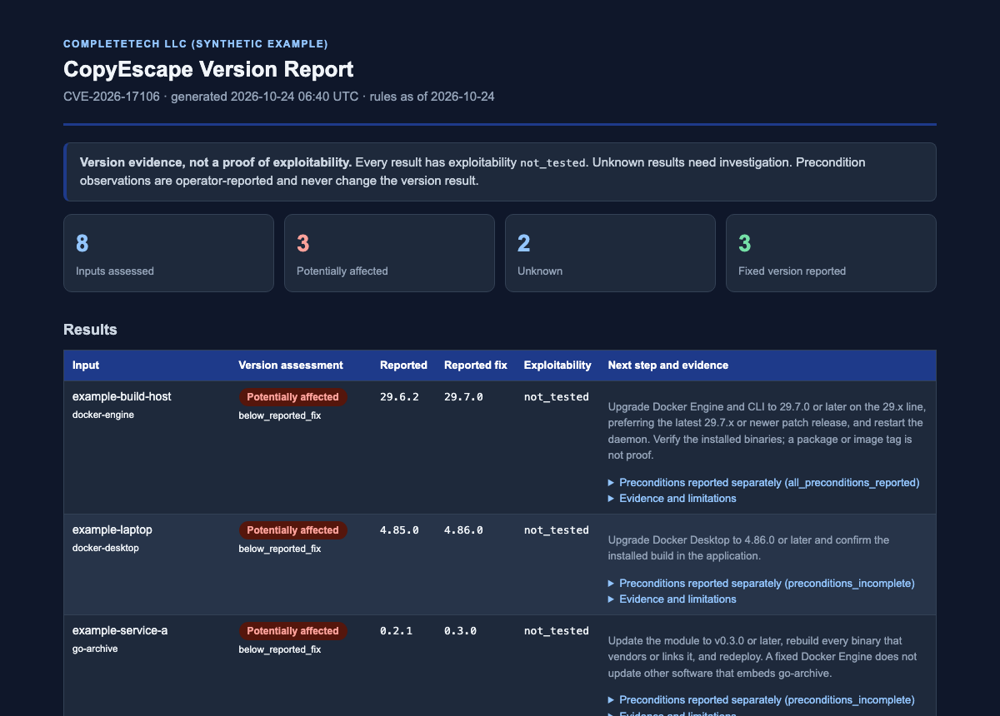

<p align="center">
  
</p>

<p align="center">
  
  
  
  <a href="LICENSING.md"></a>
</p>

<p align="center">
  <b>Docker copy destination escape</b><br>
  CVE-2026-17106 · offline version triage
</p>

---

`copyescape-check` is the dedicated repository for **CVE-2026-17106** (alias `GHSA-hfg8-hc9c-6c3h`), a flaw where a crafted archive can make `docker cp` copy-out (and other `moby/go-archive` extraction) write outside the intended destination. It is a standalone, standard-library-only Python 3.10+ tool that compares **operator-reported** versions of Docker Engine/CLI, Docker Desktop and `moby/go-archive` with the published fixes and reports uncertainty honestly. It makes no network requests, runs no Docker or application code, and never tests exploitability. By [CompleteTech LLC](https://complete.tech).

## Quick start

```sh
python copyescape_check.py --version docker-engine=29.6.2 --version go-archive=0.2.5 --format json
python copyescape_check.py --inventory inventory.json --format html --output report.html
python copyescape_check.py --csv components.csv --fail-on-finding
```

There is no installation step. On systems where Python is called `python3`, substitute it. Inputs, fields, output formats, and exit codes are documented in the [reference](docs/REFERENCE.md); run `python copyescape_check.py --help` for usage. Tests: `python -m unittest -v`.

## One exploit, one repository

| Field | Scope |
| --- | --- |
| Exploit identifier | `CVE-2026-17106` |
| Aliases for this same exploit | `GHSA-hfg8-hc9c-6c3h` |
| Rules reviewed against primary sources | 2026-10-24 |
| Implementation state | Implemented (offline version triage) |

Aliases and multiple affected products identify this same exploit; they do not create additional scanner scopes. Fixes for different vulnerabilities belong in independent repositories.

## Example report

The images show the HTML report rendered from the synthetic, reserved-name inputs in [docs/example-inventory.json](docs/example-inventory.json) (the output is [docs/example-report.html](docs/example-report.html)). They are an example of the checker's real output, not an assessment of any system.

<p align="center">
  <picture>
    <source media="(prefers-color-scheme: dark)" srcset="docs/images/report-dark.png">
    
  </picture>
</p>

<p align="center"><sub>Synthetic example generated from made-up inputs; not a real assessment.</sub></p>

## Result vocabulary

`version_status` (the `copyescape_status` field) is separate from precondition observations and from exploitability.

| Status | Meaning |
| --- | --- |
| `potentially_affected` | The reported plain version is below the reported fix on the one release line the sources cover. Not confirmed exploitability. |
| `fixed_version_reported` | The reported plain version meets the reported fix. Not a guarantee that the deployed build is patched. |
| `unknown` | Missing, malformed, prerelease, qualified, vendor/custom-build, conflicting, disputed-range, or uncovered-line versions. |

`unsupported_runtime` is not used: the vendor sources reviewed do not publish lifecycle evidence for these components in this context. Exploitability is `not_tested` for every result.

## Reported fixes

Reviewed 2026-10-24 against the primary sources below.

| Component | Reported fixed version | Line assessed | Source |
| --- | --- | --- | --- |
| Docker Engine / CLI | 29.7.0 | 29.x | Docker Engine v29 release notes |
| Docker Desktop | 4.86.0 | 4.x | Docker security announcements |
| `moby/go-archive` | 0.3.0 | 0.x | Publisher and GitHub-reviewed advisories |

Boundary handling and limits:

- **Docker Engine / CLI**: the official release notes list the fix (`go-archive` v0.3.0) under 29.7.0 (2026-07-30). Some community reports claim 29.7.2; the official notes show 29.7.1 and 29.7.2 only repair regressions introduced in 29.7.0, so 29.7.0 is the threshold. The notes do not state the earliest affected Engine version, and no 28.x or older fix is listed, so other majors are `unknown`. Treat Engine 28.x and older as an unassessed, likely unpatched line to verify with Docker, not as "probably fine".
- **Docker Desktop**: the security announcement lists the destination-escape flaw in `docker container cp` as fixed in 4.86.0. The earliest affected Desktop version is not stated, so other majors are `unknown`.
- **`moby/go-archive`**: the publisher advisory lists affected `<0.2.2`; the GitHub-reviewed entry lists `<0.3.0`; both name 0.3.0 as patched. Versions `>=0.2.2 <0.3.0` are therefore `unknown`, never safe. (No `v0.2.2` tag was found in the repository, but the checker cannot rely on that.) A fixed Docker Engine does not update other software that embeds `go-archive`.
- **Docker Sandboxes**: a "0.38.0" claim appears in community reports, but no primary source supports it (Docker's announcements mention Sandboxes only for other CVEs). No Sandboxes rule is provided; the checker rejects it explicitly.

Deployment preconditions (untrusted container or archive, `docker cp` copy-out or `go-archive` extraction, host filesystem write privileges) can be supplied as operator observations. They are reported alongside the version result and never change it.

> [!IMPORTANT]
> A version comparison is evidence, not verified runtime state. A `potentially_affected` result is not confirmed exploitability, and `fixed_version_reported` is not a safety guarantee. Vendor backports and custom builds are not detectable from a version string.

## How it works

- Offline only: operator-supplied versions via `--version`, JSON inventory, or CSV list. Version-only advisories have **no network mode**, because passive metadata cannot answer the question.
- Strict ASCII version parsing: only plain `x.y.z` (optional leading `v`) is compared; everything else stays `unknown`.
- Bounded inputs (1 MiB per file, 10,000 entries, 512-character fields) and no silent overwrite of output files.
- JSON, CSV (spreadsheet-formula safe) and script-free HTML output.

## Primary sources

1. [Docker Engine v29 release notes, 29.7.0](https://docs.docker.com/engine/release-notes/29/#2970)
2. [Docker security announcements](https://docs.docker.com/security/security-announcements/)
3. [moby/go-archive advisory GHSA-hfg8-hc9c-6c3h](https://github.com/moby/go-archive/security/advisories/GHSA-hfg8-hc9c-6c3h)
4. [GitHub Advisory Database entry](https://github.com/advisories/GHSA-hfg8-hc9c-6c3h)

Rules are a dated offline snapshot (see `rules_as_of` in every report). Recheck the advisories before relying on an old copy of this tool.

## Documentation

- [Reference](docs/REFERENCE.md): inputs, fields, outputs, exit codes
- [Implementation checklist](docs/IMPLEMENTATION.md)
- [advisory.json](advisory.json): source-preserving research record
- [Contributing](CONTRIBUTING.md) · [Security policy](SECURITY.md) · [Agent instructions](AGENTS.md)

## License

[AGPL-3.0](LICENSE), or a separate commercial agreement with CompleteTech LLC.
See [LICENSING.md](LICENSING.md) and the
[contribution terms](CONTRIBUTING.md#licensing-of-contributions).
Names and branding are governed by [BRAND_ASSETS.md](BRAND_ASSETS.md).

<p align="center">
  <sub>Built by <a href="https://complete.tech">CompleteTech LLC</a> · Innovation at Every Integration</sub>
</p>

Copyright © 2026 CompleteTech LLC.

## Offline workflow candidates (schema 1.1)

```sh
python copyescape_check.py --source docs/example-workflow.yml --source-root docs --format json
python copyescape_check.py --version docker-client=29.6.2 --version docker-engine=29.7.0 --source docs/example-workflow.yml --source-root docs --format html
```

Repeat `--source` for explicitly selected `.sh`, `.bash`, `.yml` or `.yaml`
files. `--source-root` is required; resolved sources must stay inside it.
Nothing is traversed or executed. Plain shell commands and plain/block YAML
`run:` values are tokenized for direct `docker cp` and `docker container cp`.
Relative path/line, spelling, direction and limited coverage are reported;
source strings and operands are not included. Shell continuations and simple
command separators are recognized. Comments and echo arguments are not commands.

Literal container-to-host, host-to-container and stream syntax is a candidate,
not proof of an untrusted archive, host writes, reachability or exploitation.
Variable arguments, ambiguous operands/options and mixed container endpoints
remain unknown. Drive-letter paths are not assumed to be container names.
Wrappers (including sudo), aliases, global Docker options, shell functions,
command substitution, here-documents, YAML anchors/expressions, folded/multiline
semantics and complex quoting require manual review. No supported command match
means unknown coverage, never absence or mitigation. Source rows remain unknown,
with not_tested exploitability and no inferred operator preconditions, even when
a separate reported component version is fixed.

`docker-cli` / `docker-client` now retain a separate client component instead of
normalizing to `docker-engine`. Both use their existing vendor release-note
comparison; Desktop and go-archive keep their independent thresholds. A patched
server never clears an older client observation. Legacy `docker-engine-cli`
continues to normalize to `docker-engine` for compatibility; name both components
explicitly when versions differ.

JSON/CSV schema 1.1 adds `source_path`, `source_line`, `source_spelling`,
`source_direction` and `source_coverage`; HTML renders the same evidence notes.
Every input remains bounded to 1 MiB, 100 selected files and 10,000 combined
results, with 20,000 tokens per workflow line. Inputs must be regular files;
output checks protect selected source paths and hardlink aliases even with
--force. Use stable copies; ordinary file checks are not a filesystem sandbox.
The checker invokes no Docker, shell, container copy or application command.

Command syntax provenance: [official Docker cp reference](https://docs.docker.com/reference/cli/docker/container/cp/),
reviewed 2026-10-25. Advisory thresholds and RULES_DATE are unchanged.

### Existing Docker version exports

`--docker-version FILE` (repeatable) reads an already-created Docker version
JSON or default text export. It never runs Docker. JSON `Client.Version` and
`Server.Version` (plus an explicit `Server.Components` Engine version) are
independent evidence. Default text extracts Client Version and Server Engine
Version, ignoring containerd/runc/docker-init version fields. Missing server or
conflicting versions stay unknown, with `version_candidates` retained. Client
API versions are never runtime versions. Contexts, hostnames and unrelated
metadata are not reported. Desktop's application version must still be supplied
independently; a Server title is not used as its version inventory.

Syntax provenance: [official Docker version reference](https://docs.docker.com/reference/cli/docker/version/),
reviewed 2026-10-25. This is offline export ingestion, not a local runtime
collector or attestation. Every new export input is bounded and protected from
forced output replacement like the other inputs.

Workflow logical commands are additionally bounded to 64 KiB and 256 physical lines; quoted multiline text and active backslash continuations are tracked without executing shell syntax. Folded YAML scalar bodies remain unresolved rather than being read as separate commands.

Docker export `source_instance` identifies the 1-based `--docker-version` input ordinal, hashed as a fixed public namespace plus that ordinal. It does not encode an absolute path, image, host or runtime identity. Preserve argument order for longitudinal comparisons; reordering exports changes this input identity. Unsupported quoted/folded YAML run scalars and malformed heredoc/arithmetic markers emit explicit unresolved coverage without hiding later direct commands. Operational stderr may include operator input paths from filesystem exceptions; sanitize it separately before sharing.
